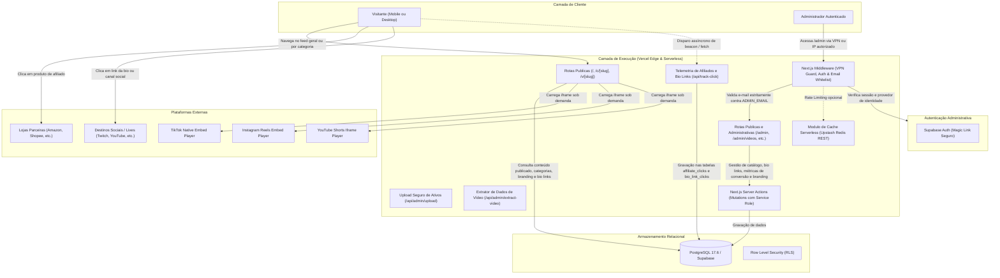

# Arquitetura Técnica — PromoCuts

Este documento detalha as decisões de engenharia, estrutura de software, fluxo de dados e mecanismos de segurança do **PromoCuts**.

---

## 1. Visão Geral e Princípios Fundamentais

O PromoCuts foi projetado em torno de três pilares:

1. **Custo Operacional Zero:** Nenhum custo de armazenamento ou transferência de vídeo. A aplicação roda 100% no plano gratuito da Vercel e do Supabase.
2. **Alta Conversão Mobile-First:** A experiência de compra é integrada diretamente à visualização de vídeos verticais (9:16), com atrito mínimo para clicar em links de afiliados ou copiar cupons.
3. **Simplicidade Clonável:** Qualquer desenvolvedor ou criador de conteúdo pode realizar um _fork_, configurar variáveis de ambiente básicas e ter sua própria vitrine em produção em poucos minutos.
4. **Arquitetura Serverless Plug-and-Play de Alta Performance:** A aplicação opera de ponta a ponta na borda da nuvem (Vercel Serverless + Supabase Cloud + Upstash Redis), eliminando custos fixos de servidores e a sobrecarga de manutenção de contêineres, enquanto entrega respostas de cache em milissegundos.

---

## 2. Diagrama Geral do Sistema



---

## 3. Motor de Embeds Nativos (Zero Storage / Zero Bandwidth)

### O Problema do Streaming Próprio

Armazenar vídeos `.mp4` em buckets de nuvem (como AWS S3 ou Cloudflare R2) e transmiti-los gera custos contínuos de CDN e processamento de transcodificação. Em projetos com tráfego viral, esse modelo inviabiliza o plano gratuito.

### A Solução por Embeds

O PromoCuts delega o armazenamento, transcodificação e distribuição de vídeo diretamente aos servidores das plataformas de origem (TikTok, Meta e Google):

| Plataforma          | Padrão de URL de Entrada                | Mecanismo de Renderização                                           | Otimização Aplicada                                        |
| :------------------ | :-------------------------------------- | :------------------------------------------------------------------ | :--------------------------------------------------------- |
| **TikTok**          | `tiktok.com/@autor/video/7123456789...` | Iframe oficial v2 (`tiktok.com/embed/v2/{id}`)                      | `loading="lazy"`, sandbox com permissões mínimas           |
| **Instagram Reels** | `instagram.com/reel/C7xyz123...`        | Iframe embed oficial (`instagram.com/reel/{id}/embed`)              | Dimensões verticais dinâmicas, script assíncrono isolado   |
| **YouTube Shorts**  | `youtube.com/shorts/dQw4w9WgXcQ`        | Iframe oficial Privacy-Enhanced (`youtube-nocookie.com/embed/{id}`) | `rel=0`, controles simplificados, sem cookies de terceiros |

### Ciclo de Parsing de URLs

No painel `/admin`, o administrador precisa apenas colar a URL original da postagem. O módulo `src/lib/embeds/parser.ts` executa expressões regulares puras para:

1. Detectar automaticamente a plataforma de origem (`tiktok`, `reels` ou `shorts`).
2. Extrair o identificador único do corte (`platform_video_id`).
3. Construir a URL padronizada de incorporação (_embed URL_).

### 3.1 Extração Automática de Metadados de Vídeo e Miniaturas Híbridas

Para agilizar o fluxo operacional de curadoria e cadastro de cortes, o PromoCuts disponibiliza extração instantânea de metadados e gestão flexível de miniaturas:

1. **Captura Automatizada via oEmbed e Open Graph (`src/lib/extractor/video-parser.ts`):**
    - Ao colar ou informar a URL pública de um vídeo no modal `/admin/videos`, a rota protegida `/api/admin/extract-video` inspeciona a origem:
        - **YouTube Shorts:** Consulta a API oficial oEmbed (`youtube.com/oembed`) retornando o título original e a miniatura em alta definição. Caso haja oscilação na rede, executa fallback determinístico para `https://img.youtube.com/vi/{id}/hqdefault.jpg`.
        - **TikTok:** Consulta a API oficial oEmbed (`tiktok.com/oembed`) simulando cabeçalhos de requisição aceitos pela plataforma, recuperando a legenda/título e a miniatura direta da CDN do TikTok.
        - **Instagram Reels:** Realiza extração defensiva via Open Graph (`og:title` e `og:image`).
    - Todos os dados extraídos preenchem dinamicamente os campos de título, slug e miniatura, permanecendo 100% editáveis pelo administrador.
    - O extrator possui blindagem estrita contra ataques de falsificação de requisição no lado do servidor (SSRF), bloqueando endereços locais e faixas de rede privada.

2. **Upload Híbrido de Miniaturas Alternativas (`src/components/ui/asset-input.tsx`):**
    - O campo de miniatura adota o componente reutilizável `AssetInput`:
        - Permite manter a miniatura capturada da plataforma de origem;
        - Permite colar qualquer link de imagem externa (CDN, Imgur, etc.);
        - Permite fazer upload direto de arquivo local (formatos PNG, JPEG, WebP e SVG de até 5 MB) via `/api/admin/upload`, armazenado no bucket `site-assets` do Supabase Storage ou em armazenamento local em ambiente de desenvolvimento;
        - Exibe pré-visualização em tempo real e botão de limpeza instantânea.

---

## 4. Camada de Segurança e Rota `/admin`

A segurança do painel administrativo é desenhada em quatro barreiras consecutivas de defesa em profundidade (_Defense in Depth_):


### Barreiras de Proteção

1. **Isolamento de Rede por VPN (Opcional):**
    - Configurado via variável `ADMIN_ALLOWED_IPS`.
    - Permite restringir o acesso ao `/admin` exclusivamente a dispositivos conectados à VPN privada (ex: Tailscale na faixa `100.64.0.0/10`, túneis WireGuard `10.0.0.0/8`, ou IPs estáticos).
    - Qualquer conexão externa que tente acessar rotas `/admin/*` tem o tráfego bloqueado imediatamente na camada de middleware antes de processar formulários ou telas de login.

2. **Autenticação Segura sem Senhas (Magic Link via Supabase Auth):**
    - O acesso ao painel `/admin` utiliza autenticação por *Magic Link* de uso único enviado diretamente para o e-mail do proprietário.
    - Elimina completamente o risco de quebra de senhas por força bruta ou dicionário.

3. **Whitelist Estrita de Identidade (`ADMIN_EMAIL`):**
    - Independentemente do método de login ou SSO utilizado, apenas o endereço configurado na variável de ambiente `ADMIN_EMAIL` recebe permissão de navegação e mutação.
    - Qualquer outro usuário autenticado por um provedor SSO de terceiros recebe um bloqueio imediato com código HTTP 403 Forbidden.

4. **Isolamento de Credenciais Sensíveis:**
    - Variáveis sensíveis como `DATABASE_URL`, `AUTH_SECRET` e `SUPABASE_SERVICE_ROLE_KEY` operam estritamente no backend (Server Actions e Route Handlers), sem exposição ao bundle do navegador.

5. **Diagnóstico Seguro e Prevenção de Vazamento de Informações (`IS_DEV` / OWASP A05):**
    - A emissão de logs detalhados e rastreamento de diagnósticos é controlada pela variável `IS_DEV` (`IS_DEV=true` ou ambiente nativo `NODE_ENV=development`).
    - Em produção (`IS_DEV=false`), mensagens internas do servidor, stack traces e detalhes de erros são omitidos das respostas ao cliente, prevenindo reconhecimento de infraestrutura por terceiros.
    - Quando ativada para depuração, a flag permite inspecionar em tempo real o parsing de URLs de vídeo, consultas do Supabase e eventos assíncronos de telemetria sem necessidade de recompilar contêineres.

---

## 5. Estratégia de Frontend e Otimização de Conversão

O design segue as diretrizes do guia de princípios de design e a especificação do **Tailwind CSS v4**:

- **Layout Mobile-First com Scroll-Snap:** A vitrine simula a fluidez de redes sociais em smartphones, permitindo deslizar entre cortes verticais sem atraso.
- **Feed Geral e Navegação por Pílulas de Categorias:** No topo da vitrine, uma barra com rolagem horizontal suave apresenta as opções de filtro com o chip "Todos" ativo por padrão. A seleção de uma categoria filtra reativamente a listagem de vídeos sem recarregamento da página. O estado é sincronizado com parâmetros de URL (`/?categoria=slug`) ou rotas diretas (`/c/[slug]`), facilitando o compartilhamento e a descoberta de nichos específicos.
- **Painel Inferior de Produtos (Bottom Drawer):** Embaixo ou sobreposto ao vídeo ativo, é apresentado um card com os produtos recomendados naquele corte, exibindo:
    - Miniatura do produto otimizada via `next/image`.
    - Nome do produto e loja parceira (ex: Amazon, Shopee).
    - Preço original riscado e preço promocional em destaque (`tabular-nums font-mono text-brand-primary`).
    - Badge de cupom clicável que copia o código para a área de transferência em um toque e exibe feedback tátil/visual imediato.
    - Botão de compra primário de alto contraste (`bg-brand-primary text-white hover:bg-brand-primary/90`) que abre a loja em nova aba com atributos `target="_blank" rel="noopener noreferrer sponsored"`.
- **Modo Desktop Elegante:** Em telas grandes, a interface migra automaticamente para uma grade de cartões com proporção 9:16, preservando a identidade visual sem esticar vídeos ou desperdiçar espaço horizontal. As pílulas de categorias permanecem fixas no topo da área de catálogo para navegação rápida.
- **Suporte a Modo Claro e Modo Escuro com Cache e Alternância Rápida:**
    - A interface adota por padrão a preferência de cor informada pelo sistema operacional e navegador do visitante (`prefers-color-scheme`).
    - Um botão único de troca de tema fica permanentemente disponível no cabeçalho (permitindo alternar diretamente entre modo claro e escuro em um toque com ícone dinâmico).
    - A escolha do usuário é gravada no armazenamento local do navegador (`localStorage` e cookie de sessão) para restauração imediata nas próximas visitas.
    - A execução de um script leve e seguro no cabeçalho (`anti-fouc script`) impede qualquer clarão ou piscamento visual antes do carregamento da página.

### 5.1 Arquitetura Modular de Componentes Públicos

A vitrine pública é organizada nos seguintes componentes em `src/components/public/` e `src/components/ui/`:

| Componente            | Arquivo                                    | Responsabilidade                                                                                                      |
| :-------------------- | :----------------------------------------- | :-------------------------------------------------------------------------------------------------------------------- |
| `PublicHeader`        | `src/components/public/header.tsx`         | Cabeçalho responsivo com logos adaptáveis ao tema (com fallback escuro -> claro), alternador de tema e links sociais. |
| `CategoryPills`       | `src/components/public/category-pills.tsx` | Barra de rolagem horizontal suave com chips de categorias e sincronização de rotas (`/` e `/c/[slug]`).               |
| `DynamicCategoryIcon` | `src/components/ui/category-icon.tsx`      | Renderizador dinâmico de ícones da biblioteca Lucide React com fallback seguro.                                       |
| `VideoPlayer`         | `src/components/public/video-player.tsx`   | Reprodutor de proporção 9:16 com lazy iframe sob demanda e pôster antecipado contra telas em branco.                  |
| `ProductCard`         | `src/components/public/product-card.tsx`   | Card com preços tabulares, crachá de desconto, cópia tátil de cupons e link protegido para parceiros.                 |
| `ProductDrawer`       | `src/components/public/product-drawer.tsx` | Gaveta retrátil mobile sobreposta ao corte, operando em modo compacto ou expandido com suporte a múltiplos produtos.  |
| `FeedMobile`          | `src/components/public/feed-mobile.tsx`    | Feed vertical com rolagem magnética (`scroll-snap` em `h-dvh`), `IntersectionObserver` e botões flutuantes.           |
| `FeedDesktop`         | `src/components/public/feed-desktop.tsx`   | Grade responsiva de cartões 9:16 com prévia de produtos e modal de reprodução imersiva.                               |
| `Feed`                | `src/components/public/feed.tsx`           | Orquestrador responsivo chaveando entre a visão mobile e a visão desktop conforme o viewport.                         |
| `Storefront`          | `src/components/public/storefront.tsx`     | Orquestrador da vitrine com filtragem de categorias em memória (0ms), resposta tátil e sincronização de histórico.    |
| `CreatorProfile`      | `src/components/public/creator-profile.tsx`| Perfil retrátil do criador com bio links, crachás dinâmicos de transmissão ("AO VIVO") e telemetria de cliques.        |

### 5.2 Algoritmo de Ranqueamento Autônomo do Feed (Recência e Dispersão Estocástica)

Para eliminar gargalos operacionais decorrentes da atribuição manual de pesos (`order_weight`) e flags estáticas de destaque (`is_featured`), o PromoCuts emprega um mecanismo autônomo de ranqueamento (`src/lib/feed/ranking.ts`). O algoritmo prioriza sistematicamente cortes recém-publicados, adicionando uma dispersão pseudo-aleatória controlada (*jitter*) para garantir dinamismo e evitar que conteúdos novos fiquem retidos no limbo da vitrine:

1. **Curva de Decaimento Temporal Suave:**
    - A pontuação base por recência adota uma função com meia-vida de 24 horas e decaimento sublinear:
      $$\text{recencyScore} = \frac{100}{1 + \left(\frac{\text{ageInHours}}{24}\right)^{0.75}}$$
    - Um vídeo recém-publicado (0 hora) recebe pontuação base máxima de 100 pontos.
    - Após 24 horas, sua pontuação base decai para 50 pontos.
    - Após 72 horas, sua pontuação atinge aproximadamente 29,8 pontos.

2. **Dispersão Estocástica Controlada (*Jitter*):**
    - Uma perturbação aleatória entre 0 e 25 pontos é adicionada à pontuação temporal:
      $$\text{jitter} \sim \mathcal{U}(0, 25)$$
      $$\text{totalScore} = \text{recencyScore} + \text{jitter}$$
    - A amplitude do *jitter* foi calibrada para permitir variações e descobertas entre conteúdos com idades próximas sem nunca permitir que vídeos antigos superem publicações frescas (um vídeo de 2 horas supera um vídeo de 7 dias mesmo sob condições extremas de *jitter*).

3. **Execução Segura no Server Component:**
    - O banco de dados (ou cache de borda Upstash Redis) fornece a listagem canônica dos vídeos ordenada por `created_at DESC`.
    - No Server Component (`src/app/page.tsx` e `src/app/c/[slug]/page.tsx`), a função `rankVideosByFreshness` pré-computa os escores de cada vídeo exatamente uma vez (aplicando *Schwartzian transform* para preservar a consistência e transitividade matemática da ordenação).
    - O resultado ordenado é entregue de forma determinística à árvore de componentes do cliente, prevenindo disparidades de hidratação (*hydration mismatch*) no navegador.

---

## 6. Motor de Customização Visual e White-Label (Theming Dinâmico e Branding)

O PromoCuts oferece uma arquitetura de customização completa orientada a dados (data-driven branding), permitindo adaptar toda a identidade da plataforma sem necessidade de recompilar código ou alterar variáveis estáticas de build.

### 6.1 Tokens Semânticos e Paleta de Cores por Tema (Tailwind CSS v4)

As cores primária e secundária da marca possuem definições independentes para o Modo Claro e para o Modo Escuro. Isso garante contraste adequado e legibilidade em qualquer ambiente de iluminação:

1. **Modo Claro:** utiliza `primary_color_light` e `secondary_color_light`.
2. **Modo Escuro:** utiliza `primary_color_dark` e `secondary_color_dark`.

No arquivo global de estilos (`src/app/globals.css`), o Tailwind CSS v4 mapeia as variáveis universais através da diretiva `@theme` e habilita a variante baseada em classe via `@custom-variant dark`:

```css
@import "tailwindcss";

@custom-variant dark (&:where(.dark, .dark *));

@theme {
    --color-brand-primary: var(--brand-primary, #10b981);
    --color-brand-secondary: var(--brand-secondary, #6366f1);
}
```

No layout raiz (`src/app/layout.tsx`), as variáveis são injetadas dinamicamente com base nas configurações da tabela `site_settings`:

```html
<style
    dangerouslySetInnerHTML="{{"
    __html:
    `
    :root
    {
    --brand-primary-light:
    ${settings.primary_color_light};
    --brand-secondary-light:
    ${settings.secondary_color_light};
    --brand-primary-dark:
    ${settings.primary_color_dark};
    --brand-secondary-dark:
    ${settings.secondary_color_dark};
    --brand-primary:
    var(--brand-primary-light);
    --brand-secondary:
    var(--brand-secondary-light);
    }
    .dark
    {
    --brand-primary:
    var(--brand-primary-dark);
    --brand-secondary:
    var(--brand-secondary-dark);
    }
    @media
    (prefers-color-scheme:
    dark)
    {
    :root:not(.light)
    {
    --brand-primary:
    var(--brand-primary-dark);
    --brand-secondary:
    var(--brand-secondary-dark);
    }
    }
    `}}
/>
```

Dessa forma, todos os componentes que utilizam as classes utilitárias de marca (`bg-brand-primary`, `text-brand-primary`, `border-brand-primary`, `ring-brand-primary`, `bg-brand-secondary`, etc.) reagem de forma automática tanto ao tema ativo quanto às cores personalizadas no painel administrativo.

### 6.2 Alternância de Tema e Persistência em Cache

O ciclo de gerenciamento de tema funciona da seguinte forma:

1. **Detecção Inicial:** Ao carregar a página pela primeira vez, o navegador consulta a preferência do sistema operacional via media query `(prefers-color-scheme: dark)`.
2. **Prevalência da Escolha do Usuário:** Se o visitante tiver selecionado manualmente um tema através do botão no cabeçalho, a preferência salva no `localStorage` sob a chave `promocuts-theme` sobrepõe a preferência do sistema.
3. **Prevenção de FOUC (Flash of Unstyled Theme):** Um script síncrono mínimo adiciona a classe `dark` à tag `<html>` antes da primeira pintura dos elementos visuais.
4. **Disponibilidade Global:** A alteração do tema propaga-se instantaneamente para todos os componentes abertos sem necessidade de recarregar a janela.

### 6.3 Metadados Dinâmicos, Favicons por Tema e Título do Navegador

A camada de borda do Next.js App Router gera os metadados de cabeçalho dinamicamente por meio da função assíncrona `generateMetadata`:

- **Título do Navegador:** Montado a partir do nome da aplicação e do slogan configurados (`settings.site_name` e `settings.site_tagline`), com suporte ao modelo de template para páginas de vídeos (`/v/[slug]`) e categorias (`/c/[slug]`).
- **Favicons Dinâmicos Adaptados ao Tema do Navegador:**
    - Os arquivos de favicon devem ser estritamente nos formatos **PNG** (`image/png`) ou **SVG** (`image/svg+xml`). O formato SVG oferece nitidez vetorial perfeita em qualquer densidade de pixels, enquanto o PNG assegura compatibilidade e transparência.
    - Se ambos os campos (`favicon_url_light` e `favicon_url_dark`) estiverem configurados, o cabeçalho emite tags `<link rel="icon">` nativas com a media query de esquema de cores do sistema:
        ```html
        <link
            rel="icon"
            href="${settings.favicon_url_light}"
            type="${mimeTypeLight}"
            media="(prefers-color-scheme: light)"
        />
        <link
            rel="icon"
            href="${settings.favicon_url_dark}"
            type="${mimeTypeDark}"
            media="(prefers-color-scheme: dark)"
        />
        ```
    - Essa abordagem dispensa JavaScript para a troca do ícone da aba, respondendo imediatamente às mudanças de tema do sistema operacional do visitante.
    - Se apenas a versão clara estiver cadastrada, ela atua como ícone universal para todos os esquemas.
- **SEO e Compartilhamento Social (Open Graph e Twitter Cards):** As meta tags de descrição (`description`), título de rede social e imagem de visualização utilizam os dados de `site_description` e `logo_url_light`, garantindo indexação precisa nos buscadores.

### 6.4 Gestão Centralizada no Painel Administrativo (`/admin/settings`)

A interface fechada de administração disponibiliza o painel `/admin/settings` para controle visual total:

1. **Identidade do Projeto:** Edição do nome da vitrine, slogan secundário, descrição institucional de SEO e texto de direitos autorais do rodapé.
2. **Paleta de Cores Dual-Theme:**
    - Cor Primária e Secundária para o **Modo Claro** (seletores interativos com código hexadecimal).
    - Cor Primária e Secundária para o **Modo Escuro** (seletores interativos com código hexadecimal).
3. **Logotipos e Ícones Adaptáveis (Exclusivamente PNG ou SVG):**
    - **Logo Principal:** `logo_url_light` e `logo_url_dark` (exibida no cabeçalho desktop). Se a versão escura não for enviada, a versão clara é reutilizada como fallback universal.
    - **Ícone Compacto Mobile:** `logo_icon_url_light` e `logo_icon_url_dark` (exibido na barra de navegação mobile). Se omitido, herda a logo principal correspondente.
    - **Favicon do Navegador:** `favicon_url_light` e `favicon_url_dark` (injetados com media queries nativas para a aba do navegador).
4. **Presença Social:** Links opcionais para os perfis da marca no Instagram, TikTok e canal no YouTube.
5. **Revalidação de Cache:** A gravação é realizada por Server Action autenticada via Service Role, disparando `revalidatePath('/', 'layout')` para que as mudanças reflitam instantaneamente para todos os visitantes sem necessidade de novo deploy.

### 6.5 Modelo Híbrido de Armazenamento de Ativos (Upload Direto e URLs Externas)

Para unir praticidade operacional com custo zero e alto desempenho, o PromoCuts adota uma arquitetura híbrida de manipulação de imagens:

1. **Armazenamento Otimizado no Banco de Dados:**
    - O PostgreSQL armazena estritamente referências em texto (`TEXT`), sem salvar binários pesados (BLOBs) nas tabelas. Isso preserva o limite gratuito de 500 MB do banco de dados e mantém as consultas SQL instantâneas.
    - A coluna aceita três tipos de valores: URLs remotas de CDNs (`https://...`), caminhos relativos locais (`/uploads/...`) ou Data URIs para vetores compactos (`data:image/svg+xml;...`).

2. **Flexibilidade Operacional no Painel (`/admin/settings`):**
    - Cada campo de ativo oferece dois modos de entrada:
        - **Modo Colar URL:** Permite apontar para arquivos já hospedados em CDNs externos, Imgur, Cloudinary ou repositórios públicos.
        - **Modo Upload Direto:** Permite selecionar o arquivo PNG ou SVG localmente através de arrastar e soltar (drag and drop).

3. **Destino do Upload por Tipo de Ambiente:**
    - **Nuvem Serverless (Supabase Storage):** O upload é enviado para o bucket público e gratuito `site-assets` do Supabase Storage. O Supabase fornece 1 GB de armazenamento de arquivos sem custos com distribuição global via CDN. O sistema grava a URL pública resultante no banco de dados.
    - **Armazenamento Local / Fallback:** Caso o Supabase Storage esteja indisponível, o upload é salvo no diretório `/public/uploads` servido estaticamente pelo Next.js.
    - **Vetores Leves:** Arquivos SVG de tamanho inferior a 64 KB podem opcionalmente ser codificados como Data URI direto, dispensando qualquer dependência de bucket.

---

## 7. Métricas Anônimas de Afiliados, Bio Links e Telemetria

Para avaliar quais cortes, produtos e canais sociais geram maior retorno sem comprometer a privacidade do visitante:

1. **Disparo Client-Side Não Bloqueante (`src/lib/telemetry.ts`):**
    - Cada clique em "Comprar" ou "Copiar Cupom" no componente `ProductCard` dispara a função auxiliar `trackAffiliateClick(productId, videoId, linkId, storeName)`.
    - Cada clique em um link do agregador no componente `CreatorProfile` dispara a função auxiliar `trackBioLinkClick(bioLinkId)`.
    - O envio utiliza a API nativa `navigator.sendBeacon` com payload em Blob JSON, permitindo que a requisição ocorra de forma assíncrona mesmo quando o usuário é redirecionado para a loja parceira ou canal social em outra aba.
    - Se a API de beacon não estiver disponível ou falhar, o utilitário executa um fallback para `fetch` com a flag `keepalive: true`.
    - Toda a execução no cliente é envolvida em tratamento defensivo de exceções para que bloqueadores de anúncios (ad blockers) ou instabilidades de rede jamais impeçam a navegação, a abertura de canais ou a cópia do cupom.

2. **Route Handler Endurecido (`src/app/api/track-click`):**
    - A rota recebe os identificadores via requisição HTTP `POST`.
    - **Validação Estrita de Identificadores:** Valida o formato dos parâmetros `product_id`, `video_id`, `link_id` e `bio_link_id` contra uma expressão regular estrita de UUID, rejeitando requisições malformadas ou tentativas de injeção com código HTTP `400 Bad Request`. Exige que ao menos um identificador principal (`product_id` ou `bio_link_id`) esteja presente.
    - **Mitigação contra Esgotamento de Disco (Storage DoS):** Os cabeçalhos `user-agent` e `referrer` são higienizados e truncados no servidor (máximo de 512 caracteres para `user-agent` e 1024 caracteres para `referrer`), em estrita conformidade com os limites do banco de dados.
    - **Persistência Assíncrona e Gatilhos Atômicos:** 
        - Cliques em afiliados são gravados na tabela `public.affiliate_clicks`.
        - Cliques em bio links são gravados na tabela `public.bio_link_clicks`, disparando o gatilho `handle_bio_link_click_increment()` que incrementa atomicamente o contador `clicks_count` na tabela `public.bio_links`.
    - **Privacidade por Padrão:** Nenhum dado pessoal identificável (como endereço IP completo, cookies de sessão ou parâmetros de rastreamento invasivos) é persistido.

---

## 8. Camada de Cache Serverless e Cabeçalhos Defensivos (Upstash Redis & Next.js Security)

Para atingir carregamento instantâneo da vitrine pública com latência inferior a 5 milissegundos sem custos de infraestrutura e sem necessidade de gerenciar servidores ou contêineres dedicados, o PromoCuts implementa uma arquitetura híbrida de cache serverless e segurança nativa:

### 8.1 Cache em Memória Serverless: Upstash Redis

- **Comunicação REST/HTTP:** Utiliza a biblioteca oficial `@upstash/redis` operando via requisições HTTP rápidas e sem estado (*stateless*), eliminando o esgotamento de conexões TCP típico de ambientes serverless (Vercel Lambdas e Edge Functions).
- **Chaves de Cache Consolidadas:**
  - `promocuts:settings:singleton`: Configurações de marca, título, descrição, cores dual-theme e logotipos (TTL de 600 segundos).
  - `promocuts:categories:all`: Lista ordenada de categorias ativas para a barra de pílulas (TTL de 300 segundos).
  - `promocuts:feed:all`: Feed completo de cortes de vídeo com produtos e categorias vinculados (TTL de 300 segundos).
- **Degradação Graciosa (Resiliência Operacional):** Caso as variáveis `UPSTASH_REDIS_REST_URL` e `UPSTASH_REDIS_REST_TOKEN` não sejam fornecidas (ou em caso de instabilidade de rede), a aplicação faz fallback silencioso e transparente para consultas diretas ao Supabase, preservando o funcionamento contínuo do sistema sem lançar exceções aos visitantes.
- **Invalidação Atômica nas Mutações:** Sempre que o administrador cria, edita ou remove categorias, produtos, vídeos ou configurações de marca no painel `/admin`, a função `invalidateFeedCache()` purga imediatamente as chaves no Upstash Redis junto com a revalidação nativa do App Router (`revalidatePath`), garantindo que novas publicações fiquem imediatamente visíveis para o público.

### 8.2 Cabeçalhos de Segurança Nativos no Next.js (`next.config.ts`)

Substituindo a necessidade de um gateway Nginx intermediário, as diretivas de proteção HTTP são injetadas diretamente na borda do Next.js através de `async headers()`:

- **Content-Security-Policy (CSP):** Política restritiva que bloqueia fontes desconhecidas e autoriza estritamente os domínios oficiais dos reprodutores de vídeo (`https://www.tiktok.com`, `https://www.instagram.com`, `https://www.youtube.com`, `https://www.youtube-nocookie.com`).
- **X-Content-Type-Options: nosniff:** Impede que navegadores interpretem arquivos com tipos MIME incorretos (mitigação de *MIME confusion*).
- **X-Frame-Options: SAMEORIGIN:** Protege a interface administrativa contra ataques de *clickjacking*.
- **Referrer-Policy: strict-origin-when-cross-origin:** Garante que informações sensíveis de rotas e parâmetros não vazem para domínios de terceiros.
- **Permissions-Policy:** Desativa acesso desnecessário a recursos do dispositivo do visitante (`camera=(), microphone=(), geolocation=(), payment=()`).

---

## 9. Automação de Ofertas, Suporte Multi-Loja e Monitoramento Serverless (Fase 8)

Para maximizar a conversão de vendas, a velocidade operacional do gestor e a confiabilidade dos links sem gerar custos adicionais, o PromoCuts implementa a camada de automação de ofertas e auditoria contínua:

### 9.1 Catálogo Multi-Loja e Comparador Dinâmico de Ofertas

- **Flexibilidade Relacional (1:N):** Cada item do catálogo pode possuir múltiplos links afiliados de diferentes plataformas (Amazon, Shopee, Mercado Livre, AliExpress, Magalu, Kabum, etc.), cada um com preço regular, preço promocional e cupom específicos.
- **Retrocompatibilidade com a Tabela `products`:** A tabela `public.products` armazena os valores da loja primária para preservar integrações existentes, enquanto `public.product_links` gerencia a totalidade das ofertas vinculadas.
- **Experiência Comparativa sem Atrito:** Tanto no `ProductCard` quanto no `ProductDrawer`, o visitante visualiza botões de alternância rápida entre lojas parceiras. A seleção recalcula dinamicamente o preço, o badge de desconto e o código do cupom.
- **Telemetria com Discriminação de Loja:** Ao clicar em "Comprar" ou copiar cupom, a função `trackAffiliateClick` envia os parâmetros `link_id` e `store_name`, permitindo auditar com exatidão qual parceiro gera maior volume de saídas.

### 9.2 Extrator Open Graph Defensivo (Proteção Ativa contra SSRF)

- **Autopreenchimento de Produtos:** No painel administrativo (`/admin/products`), o administrador cola a URL de um produto e clica em "Autopreencher". O endpoint protegido `/api/admin/extract-og` inspeciona a página remota e extrai título, imagem, preço sugerido e identifica a loja parceira de forma instantânea.
- **Mitigação Estrita de SSRF (Server-Side Request Forgery):**
  - Protocolos restritos exclusivamente a `http:` e `https:`.
  - Bloqueio imediato de nomes locais (`localhost`, `*.local`, `*.internal`, `*.lan`).
  - Bloqueio de endereços IP de loopback (`127.0.0.1`, `::1`, `0.0.0.0`).
  - Bloqueio de faixas privadas RFC 1918 (`10.0.0.0/8`, `172.16.0.0/12`, `192.168.0.0/16`).
  - Bloqueio de endereços link-local e metadados de nuvem (`169.254.0.0/16`, incluindo o endpoint `169.254.169.254`).
- **Consumo Mínimo de Recursos:** As requisições utilizam timeout de 5 segundos e leitor de stream limitado a 512 KB, interrompendo a transferência assim que a tag `</head>` é detectada.

### 9.3 Monitoramento Periódico de Integridade via Vercel Cron Job

- **Auditoria Serverless de Baixo Custo:** A rota `/api/cron/check-offers` é executada automaticamente uma vez ao dia pela infraestrutura gratuita da Vercel (conforme agendamento em `vercel.json`: `"schedule": "0 3 * * *"`).
- **Proteção por Segredo de Cron (`CRON_SECRET`):** Requisições externas devem fornecer o cabeçalho `Authorization: Bearer ${CRON_SECRET}` para execução autorizada.
- **Checagem Leve por Cabeçalhos HTTP:** O utilitário `checkOfferLink` realiza requisições `HEAD` (com fallback para `GET` cancelado no stream) seguindo redirecionamentos para classificar links como disponíveis (`200..399`) ou inativos (`404`, `410`).
- **Alertas Visuais no Painel:** Links com falha são sinalizados na tabela de produtos com insígnia de alerta ("Revisar"), permitindo ao gestor filtrar produtos com problemas e auditar links manualmente via Server Action (`checkOffersAction`).

---

## 10. Hub Central do Criador (Bio Links, Streamers e Dashboard de Métricas)

Na Fase 9, o PromoCuts expandiu sua arquitetura para consolidar a vitrine pública como o hub definitivo de tráfego do criador de conteúdo, unindo agregador de bio links, integração para canais de streaming e painel gerencial de conversão.

### 10.1 Gestão de Bio Links e Redes Sociais no Painel (`/admin/bio-links`)

- **Controle Centralizado e Ordenação:** Rota fechada que permite cadastrar destinos externos (Twitch, Kick, YouTube, Discord, Telegram, WhatsApp, PIX, Apoia-se, etc.) com reordenação direta, alternância de visibilidade e prévia em tempo real.
- **Catálogo Vetorial Nativo:** Ícones SVG oficiais de plataformas integrados em `src/app/admin/bio-links/bio-link-icons.tsx`, eliminando bibliotecas de ícones pesadas e mantendo custo zero.
- **Crachás de Destaque e Efeito Pulsante:** Suporte a etiquetas chamativas ("AO VIVO", "NOVO", "VIP", "DESCONTO", "OFICIAL") com opção de animação de pulso para direcionar o tráfego a transmissões ou promoções urgentes.
- **Contadores de Cliques em Tempo Real:** Cada link possui contagem acumulada atualizada automaticamente no banco relacional via gatilho atômico.

### 10.2 Perfil Retrátil do Criador na Vitrine Pública (`CreatorProfile`)

- **Componente Mobile-First:** Integrado ao topo do feed principal (`/`) e das páginas de categoria (`/c/[slug]`), o componente `src/components/public/creator-profile.tsx` exibe o avatar e nome do criador em formato compacto, expandindo suavemente em uma gaveta de links em estilo cartão com um toque.
- **Sinalização Dinâmica de Transmissão:** Caso exista algum link configurado com o crachá "AO VIVO", o avatar do perfil exibe um anel pulsante de destaque imediato, avisando os visitantes da transmissão em andamento.
- **Aceleração via Cache Serverless:** Os bio links ativos são carregados conjuntamente com o feed e preservados em cache no Upstash Redis (`promocuts:bio_links:all`), garantindo renderização instantânea sem sobrecarga ao banco.

### 10.3 Dashboard Nativo de Métricas e Conversão (`/admin/metrics`)

- **Zero Dependências Externas (Custo Operacional Zero):** Gráficos e visualizações construídos exclusivamente com vetores SVG nativos e classes utilitárias do Tailwind CSS v4, dispensando bibliotecas pesadas de visualização como Chart.js ou Recharts.
- **Agrupamento Temporal e Filtros:** Seletor de período dinâmico (Hoje, 7 dias e 30 dias) com limites temporais estritos calculados pelo utilitário `src/lib/analytics.ts` (`getDateRangeBounds`).
- **Indicadores Chave de Desempenho (KPIs):** Total de saídas para lojas parceiras, cliques consolidados em bio links, volume total de intenções de conversão e média diária.
- **Classificação Inteligente de Fontes de Tráfego:** O utilitário `parseTrafficSource` categoriza automaticamente origens de referência, incluindo esquemas de aplicativos nativos móveis (`android-app://com.instagram.android`, `tiktok`, `youtube`, etc.), domínios web e tráfego direto.
- **Rankings Analíticos de Desempenho:**
  - Distribuição percentual de saída por loja parceira.
  - Origens de tráfego com gráficos de barra de preenchimento proporcional.
  - Tabela dos produtos mais clicados com identificação de loja e preço.
  - Tabela dos vídeos com maior taxa de conversão vinculada.
  - Tabela de bio links com contadores consolidados no período selecionado.


