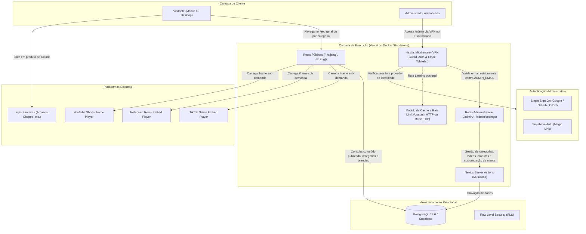
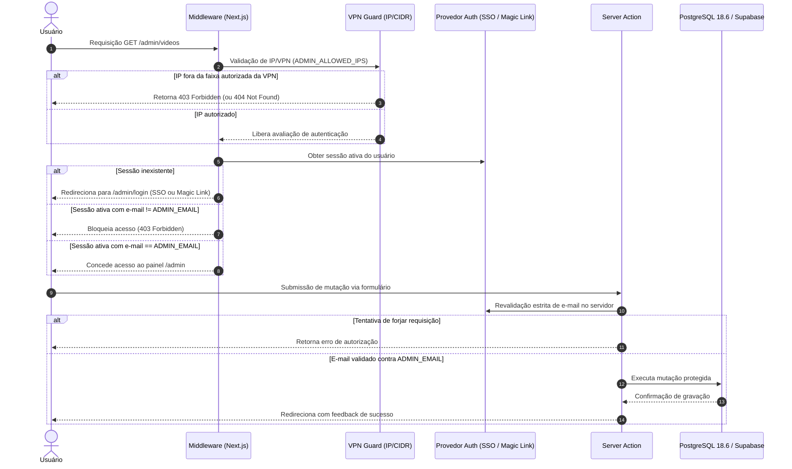

# Arquitetura Técnica — PromoCuts

Este documento detalha as decisões de engenharia, estrutura de software, fluxo de dados e mecanismos de segurança do **PromoCuts**.

---

## 1. Visão Geral e Princípios Fundamentais

O PromoCuts foi projetado em torno de três pilares:

1. **Custo Operacional Zero:** Nenhum custo de armazenamento ou transferência de vídeo. A aplicação roda 100% no plano gratuito da Vercel e do Supabase.
2. **Alta Conversão Mobile-First:** A experiência de compra é integrada diretamente à visualização de vídeos verticais (9:16), com atrito mínimo para clicar em links de afiliados ou copiar cupons.
3. **Simplicidade Clonável:** Qualquer desenvolvedor ou criador de conteúdo pode realizar um _fork_, configurar variáveis de ambiente básicas e ter sua própria vitrine em produção em poucos minutos.
4. **Independência de Infraestrutura (Portabilidade Total):** A aplicação não possui aprisionamento tecnológico (_vendor lock-in_), podendo rodar em nuvem serverless (Vercel + Supabase) ou totalmente auto-hospedada via Docker Compose (PostgreSQL 18.6, Redis e Next.js Standalone).

---

## 2. Diagrama Geral do Sistema



---

## 3. Motor de Embeds Nativos (Zero Storage / Zero Bandwidth)

### O Problema do Streaming Próprio

Armazenar vídeos `.mp4` em buckets de nuvem (como AWS S3 ou Cloudflare R2) e transmiti-los gera custos contínuos de CDN e processamento de transcodificação. Em projetos com tráfego viral, esse modelo inviabiliza o plano gratuito.

### A Solução por Embeds

O PromoCuts delega o armazenamento, transcodificação e distribuição de vídeo diretamente aos servidores das plataformas de origem (TikTok, Meta e Google):

| Plataforma          | Padrão de URL de Entrada                | Mecanismo de Renderização                                           | Otimização Aplicada                                        |
| :------------------ | :-------------------------------------- | :------------------------------------------------------------------ | :--------------------------------------------------------- |
| **TikTok**          | `tiktok.com/@autor/video/7123456789...` | Iframe oficial v2 (`tiktok.com/embed/v2/{id}`)                      | `loading="lazy"`, sandbox com permissões mínimas           |
| **Instagram Reels** | `instagram.com/reel/C7xyz123...`        | Iframe embed oficial (`instagram.com/reel/{id}/embed`)              | Dimensões verticais dinâmicas, script assíncrono isolado   |
| **YouTube Shorts**  | `youtube.com/shorts/dQw4w9WgXcQ`        | Iframe oficial Privacy-Enhanced (`youtube-nocookie.com/embed/{id}`) | `rel=0`, controles simplificados, sem cookies de terceiros |

### Ciclo de Parsing de URLs

No painel `/admin`, o administrador precisa apenas colar a URL original da postagem. O módulo `lib/embeds/parser.ts` executa expressões regulares puras para:

1. Detectar automaticamente a plataforma de origem (`tiktok`, `reels` ou `shorts`).
2. Extrair o identificador único do corte (`platform_video_id`).
3. Construir a URL padronizada de incorporação (_embed URL_).

---

## 4. Camada de Segurança e Rota `/admin`

A segurança do painel administrativo é desenhada em quatro barreiras consecutivas de defesa em profundidade (_Defense in Depth_):



### Barreiras de Proteção

1. **Isolamento de Rede por VPN (Opcional):**
    - Configurado via variável `ADMIN_ALLOWED_IPS`.
    - Permite restringir o acesso ao `/admin` exclusivamente a dispositivos conectados à VPN privada (ex: Tailscale na faixa `100.64.0.0/10`, túneis WireGuard `10.0.0.0/8`, ou IPs estáticos).
    - Qualquer conexão externa que tente acessar rotas `/admin/*` tem o tráfego bloqueado imediatamente na camada de middleware antes de processar formulários ou telas de login.

2. **Autenticação Híbrida (SSO Corporativo ou Magic Link):**
    - **No Docker / Self-Hosted:** Suporte a Single Sign-On (SSO) via OAuth2 e OpenID Connect (Google Workspace, GitHub ou provedores OIDC corporativos como Authentik, Keycloak e Authelia).
    - **Na Nuvem Serverless:** Autenticação via _Magic Link_ seguro enviado para o e-mail do proprietário através do Supabase Auth.

3. **Whitelist Estrita de Identidade (`ADMIN_EMAIL`):**
    - Independentemente do método de login ou SSO utilizado, apenas o endereço configurado na variável de ambiente `ADMIN_EMAIL` recebe permissão de navegação e mutação.
    - Qualquer outro usuário autenticado por um provedor SSO de terceiros recebe um bloqueio imediato com código HTTP 403 Forbidden.

4. **Isolamento de Credenciais Sensíveis:**
    - Variáveis sensíveis como `DATABASE_URL`, `AUTH_SECRET` e `SUPABASE_SERVICE_ROLE_KEY` operam estritamente no backend (Server Actions e Route Handlers), sem exposição ao bundle do navegador.

---

## 5. Estratégia de Frontend e Otimização de Conversão

O design segue as diretrizes do guia de princípios de design e a especificação do **Tailwind CSS v4**:

- **Layout Mobile-First com Scroll-Snap:** A vitrine simula a fluidez de redes sociais em smartphones, permitindo deslizar entre cortes verticais sem atraso.
- **Feed Geral e Navegação por Pílulas de Categorias:** No topo da vitrine, uma barra com rolagem horizontal suave apresenta as opções de filtro com o chip "Todos" ativo por padrão. A seleção de uma categoria filtra reativamente a listagem de vídeos sem recarregamento da página. O estado é sincronizado com parâmetros de URL (`/?categoria=slug`) ou rotas diretas (`/c/[slug]`), facilitando o compartilhamento e a descoberta de nichos específicos.
- **Painel Inferior de Produtos (Bottom Drawer):** Embaixo ou sobreposto ao vídeo ativo, é apresentado um card com os produtos recomendados naquele corte, exibindo:
    - Miniatura do produto otimizada via `next/image`.
    - Nome do produto e loja parceira (ex: Amazon, Shopee).
    - Preço original riscado e preço promocional em destaque (`tabular-nums font-mono text-brand-primary`).
    - Badge de cupom clicável que copia o código para a área de transferência em um toque e exibe feedback tátil/visual imediato.
    - Botão de compra primário de alto contraste (`bg-brand-primary text-white hover:bg-brand-primary/90`) que abre a loja em nova aba com atributos `target="_blank" rel="noopener noreferrer sponsored"`.
- **Modo Desktop Elegante:** Em telas grandes, a interface migra automaticamente para uma grade de cartões com proporção 9:16, preservando a identidade visual sem esticar vídeos ou desperdiçar espaço horizontal. As pílulas de categorias permanecem fixas no topo da área de catálogo para navegação rápida.

---

## 6. Motor de Customização Visual e White-Label (Theming Dinâmico e Branding)

O PromoCuts oferece uma arquitetura de customização completa orientada a dados (data-driven branding), permitindo adaptar toda a identidade da plataforma sem necessidade de recompilar código ou alterar variáveis estáticas de build.

### 6.1 Tokens Semânticos e Integração com Tailwind CSS v4

A estilização visual utiliza o motor de variáveis de tema do Tailwind CSS v4 via diretiva `@theme` no arquivo global de estilos:

```css
@import "tailwindcss";

@theme {
    --color-brand-primary: var(--brand-primary, #10b981);
    --color-brand-secondary: var(--brand-secondary, #6366f1);
}
```

No layout raiz (`app/layout.tsx`), as variáveis CSS customizadas são injetadas diretamente na tag `<html>` com base nas configurações ativas recuperadas da tabela `site_settings`:

```tsx
<html
  lang="pt-BR"
  style={{
    '--brand-primary': settings.primary_color,
    '--brand-secondary': settings.secondary_color,
  } as React.CSSProperties}
>
```

Dessa forma, todos os componentes e utilitários da interface que utilizam as classes de marca (`bg-brand-primary`, `text-brand-primary`, `border-brand-primary`, `ring-brand-primary`, `bg-brand-secondary`, etc.) reagem instantaneamente às cores configuradas pelo administrador.

### 6.2 Metadados Dinâmicos, Favicon e Título do Navegador

A camada de borda do Next.js App Router gera os metadados de cabeçalho dinamicamente por meio da função assíncrona `generateMetadata`:

- **Título do Navegador:** Montado a partir do nome da aplicação e do slogan configurados (`settings.site_name` e `settings.site_tagline`), com suporte ao modelo de template para páginas de vídeos (`/v/[slug]`) e categorias (`/c/[slug]`).
- **Favicon e Ícones de Dispositivos:** Se uma URL customizada for informada no campo `favicon_url`, ela é vinculada dinamicamente nas tags `<link rel="icon">` e `<link rel="apple-touch-icon">`, substituindo o favicon padrão da aplicação.
- **SEO e Compartilhamento Social (Open Graph e Twitter Cards):** As meta tags de descrição (`description`), título de rede social e imagem de visualização utilizam os dados de `site_description` e `logo_url`, garantindo indexação precisa nos buscadores.

### 6.3 Gestão Centralizada no Painel Administrativo (`/admin/settings`)

A interface fechada de administração disponibiliza o painel `/admin/settings` para controle visual total:

1. **Identidade do Projeto:** Edição do nome da vitrine, slogan secundário, descrição institucional de SEO e texto de direitos autorais do rodapé.
2. **Paleta de Cores:** Seletor visual interativo (color picker nativo e código hexadecimal) para alteração em tempo real das cores primária e secundária.
3. **Logotipos e Ícones:** Definição das URLs da logo principal (header desktop), logo compacta (header mobile) e favicon.
4. **Presença Social:** Links opcionais para os perfis da marca no Instagram, TikTok e canal no YouTube.
5. **Revalidação de Cache:** A gravação é realizada por Server Action autenticada via Service Role, disparando `revalidatePath('/', 'layout')` para que as mudanças reflitam instantaneamente para todos os visitantes sem necessidade de novo deploy.

---

## 7. Métricas Anônimas de Afiliados

Para avaliar quais cortes e produtos geram maior retorno sem comprometer a privacidade do visitante:

- Cada clique em "Comprar" ou "Copiar Cupom" dispara uma requisição leve em background para `/api/track-click`.
- A rota registra apenas: `product_id`, `video_id`, `timestamp`, `referrer` e `user_agent`.
- Nenhum dado pessoal identificável (como IP completo ou cookies de rastreamento) é armazenado.

---

## 8. Arquitetura de Contêineres e Self-Hosting (Docker)

Para garantir autonomia e independência de fornecedores de nuvem, o PromoCuts disponibiliza orquestração completa em contêineres estruturada no princípio de Defesa em Profundidade:

### 8.1 Gateway e Reverse Proxy: Nginx (Porta 80)

- **Ponto Único de Entrada:** O contêiner `promocuts-nginx` é o único serviço que expõe porta para a máquina hospedeira (`80:80`).
- **Terminação SSL Delegada à Nuvem:** A porta `443` (HTTPS) e os certificados SSL são gerenciados na camada de borda pela infraestrutura de nuvem (como Cloudflare, AWS ALB ou Load Balancers). O Nginx mapeia com segurança o cabeçalho `$proxy_x_forwarded_proto` prevenindo falsificação de HTTPS.
- **Segregação Rigorosa de Redes:** A infraestrutura é segmentada em duas redes isoladas:
  - `frontend-network`: conecta exclusivamente o `promocuts-nginx` e o `promocuts-app`.
  - `backend-network` (marcada como `internal: true`): conecta exclusivamente o `promocuts-app`, `promocuts-db` e `promocuts-redis`. O Nginx não possui rota física nem resolução DNS para alcançar o PostgreSQL ou Redis, impedindo pivoteamento em caso de comprometimento da borda.
- **Cabeçalhos de Segurança Defensivos e Rate Limiting:** O Nginx aplica políticas de `Content-Security-Policy` (permitindo estritamente players de TikTok, Reels e Shorts), `X-Frame-Options`, `X-Content-Type-Options`, `Referrer-Policy` e `Permissions-Policy`, além de zonas de rate limiting (`limit_req_zone`) para requisições gerais e rotas administrativas (`/admin`).

### 8.2 Next.js Standalone Runner

- **Build Multi-Stage Endurecido:** O arquivo `Dockerfile` compila o frontend e o servidor Next.js utilizando o recurso nativo `output: 'standalone'`.
- **Gerenciador de Processos Tini:** Utiliza `tini` como entrypoint (PID 1) para tratamento adequado de sinais UNIX (`SIGTERM`/`SIGINT`), viabilizando encerramento gracioso (*graceful shutdown*) sem corromper transações de banco.
- **Healthcheck Nativo:** Monitoramento integrado de integridade via comando local para orquestradores.
- **Segurança de Execução:** O processo roda sob o usuário sem privilégios de root (`nextjs:nodejs`), acessível apenas internamente pelo Nginx na porta `3000`.

### 8.3 Banco de Dados Dedicado: PostgreSQL 18.6

- **Versão:** O serviço de banco de dados utiliza a imagem oficial `postgres:18.6-alpine`.
- **Inicialização Idempotente:** O volume `./supabase/migrations` é montado em `/docker-entrypoint-initdb.d/`. Na primeira inicialização, todos os scripts SQL (`001_initial_schema.sql`, `002_add_categories.sql` e `003_add_site_settings.sql`) são aplicados automaticamente, preparando tabelas, enums, triggers e o registro inicial de configurações de marca com validação de formato e RLS ativo.
- **Credenciais Seguras:** Exigência de senhas fortes via variável obrigatória `POSTGRES_PASSWORD`, sem fallbacks para credenciais padrão conhecidas.
- **Persistência Segura:** Os arquivos de dados residem no volume nomeado `postgres_data`, sem exposição de portas para a máquina externa.

### 8.4 Camada Opcional de Redis 8 em Contêiner

- **100% Opcional:** O sistema PromoCuts opera com autonomia plena sem a presença do Redis tanto em nuvem quanto no Docker.
- **Instância Local Autenticada:** Quando habilitado, o serviço `redis` executa a imagem oficial `redis:8-alpine` com persistência periódica em disco (`--save 60 1`) e proteção por senha configurada via flag `--requirepass` e variável `REDIS_PASSWORD` na rede interna backend.
- **Tolerância a Falhas:** Caso o contêiner de Redis seja interrompido, a aplicação continua operando normalmente através de consultas diretas ao banco de dados e cache em memória de processo.
