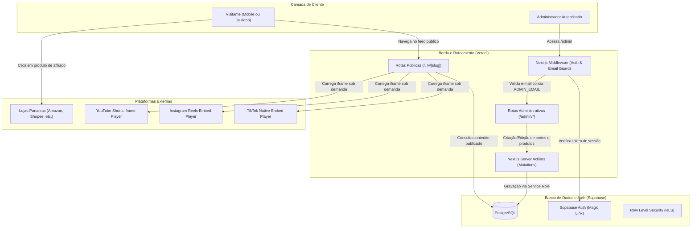
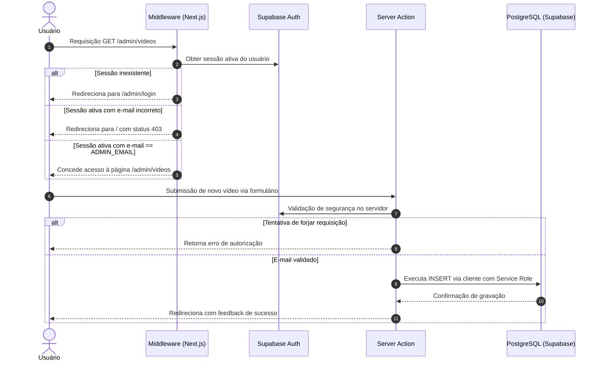

# Arquitetura Técnica — PromoCuts

Este documento detalha as decisões de engenharia, estrutura de software, fluxo de dados e mecanismos de segurança do **PromoCuts**.

---

## 1. Visão Geral e Princípios Fundamentais

O PromoCuts foi projetado em torno de três pilares:

1. **Custo Operacional Zero:** Nenhum custo de armazenamento ou transferência de vídeo. A aplicação roda 100% no plano gratuito da Vercel e do Supabase.
2. **Alta Conversão Mobile-First:** A experiência de compra é integrada diretamente à visualização de vídeos verticais (9:16), com atrito mínimo para clicar em links de afiliados ou copiar cupons.
3. **Simplicidade Clonável:** Qualquer desenvolvedor ou criador de conteúdo pode realizar um _fork_, configurar quatro variáveis de ambiente e ter sua própria vitrine em produção em menos de cinco minutos.

---

## 2. Diagrama Geral do Sistema

---

## 3. Motor de Embeds Nativos (Zero Storage / Zero Bandwidth)

### O Problema do Streaming Próprio

Armazenar vídeos `.mp4` em buckets de nuvem (como AWS S3 ou Cloudflare R2) e transmiti-los gera custos contínuos de CDN e processamento de transcodificação. Em projetos com tráfego viral, esse modelo inviabiliza o plano gratuito.

### A Solução por Embeds

O PromoCuts delega o armazenamento, transcodificação e distribuição de vídeo diretamente aos servidores das plataformas de origem (TikTok, Meta e Google):

| Plataforma          | Padrão de URL de Entrada                | Mecanismo de Renderização                                           | Otimização Aplicada                                        |
| :------------------ | :-------------------------------------- | :------------------------------------------------------------------ | :--------------------------------------------------------- |
| **TikTok**          | `tiktok.com/@autor/video/7123456789...` | Iframe oficial v2 (`tiktok.com/embed/v2/{id}`)                      | `loading="lazy"`, sandbox com permissões mínimas           |
| **Instagram Reels** | `instagram.com/reel/C7xyz123...`        | Iframe embed oficial (`instagram.com/reel/{id}/embed`)              | Dimensões verticais dinâmicas, script assíncrono isolado   |
| **YouTube Shorts**  | `youtube.com/shorts/dQw4w9WgXcQ`        | Iframe oficial Privacy-Enhanced (`youtube-nocookie.com/embed/{id}`) | `rel=0`, controles simplificados, sem cookies de terceiros |

### Ciclo de Parsing de URLs

No painel `/admin`, o administrador precisa apenas colar a URL original da postagem. O módulo `lib/embeds/parser.ts` executa expressões regulares puras para:

1. Detectar automaticamente a plataforma de origem (`tiktok`, `reels` ou `shorts`).
2. Extrair o identificador único do corte (`platform_video_id`).
3. Construir a URL padronizada de incorporação (_embed URL_).

---

## 4. Camada de Segurança e Rota `/admin`

A segurança do painel administrativo é desenhada em três barreiras consecutivas:

### Barreiras de Proteção

1. **Autenticação com Supabase Auth:** O acesso utiliza _Magic Link_ seguro encaminhado diretamente para a caixa de entrada do proprietário da instância.
2. **Whitelist de E-mail via Ambiente:** Apenas o endereço registrado na variável de ambiente `ADMIN_EMAIL` recebe permissão de navegação e mutação. Qualquer outro usuário autenticado é sumariamente bloqueado.
3. **Isolamento de Credenciais Sensíveis:** A chave de serviço `SUPABASE_SERVICE_ROLE_KEY` é mantida exclusivamente no lado do servidor em Server Actions e Route Handlers, nunca sendo exposta ao bundle do cliente.

---

## 5. Estratégia de Frontend e Otimização de Conversão

O design segue as diretrizes do guia de princípios de design e a especificação do **Tailwind CSS v4**:

- **Layout Mobile-First com Scroll-Snap:** A vitrine simula a fluidez de redes sociais em smartphones, permitindo deslizar entre cortes verticais sem atraso.
- **Painel Inferior de Produtos (Bottom Drawer):** Embaixo ou sobreposto ao vídeo ativo, é apresentado um card com os produtos recomendados naquele corte, exibindo:
    - Miniatura do produto otimizada via `next/image`.
    - Nome do produto e loja parceira (ex: Amazon, Shopee).
    - Preço original riscado e preço promocional em destaque (`tabular-nums font-mono text-emerald-400`).
    - Badge de cupom clicável que copia o código para a área de transferência em um toque e exibe feedback tátil/visual imediato.
    - Botão de compra primário de alto contraste que abre a loja em nova aba com atributos `target="_blank" rel="noopener noreferrer sponsored"`.
- **Modo Desktop Elegante:** Em telas grandes, a interface migra automaticamente para uma grade de cartões com proporção 9:16, preservando a identidade visual sem esticar vídeos ou desperdiçar espaço horizontal.

---

## 6. Métricas Anônimas de Afiliados

Para avaliar quais cortes e produtos geram maior retorno sem comprometer a privacidade do visitante:

- Cada clique em "Comprar" ou "Copiar Cupom" dispara uma requisição leve em background para `/api/track-click`.
- A rota registra apenas: `product_id`, `video_id`, `timestamp`, `referrer` e `user_agent`.
- Nenhum dado pessoal identificável (como IP completo ou cookies de rastreamento) é armazenado.
