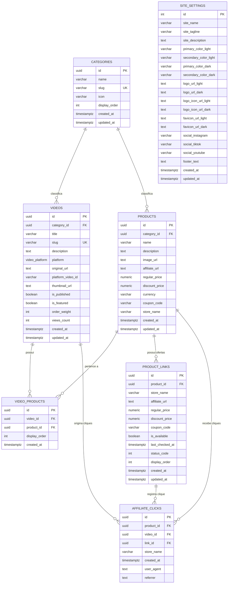

# Modelagem e Dicionário do Banco de Dados — PromoCuts

Este documento documenta o esquema de banco de dados do **PromoCuts**, construído sobre o **PostgreSQL** gerenciado pelo **Supabase**.

---

## 1. Diagrama Entidade-Relacionamento (ERD)

---

## 2. Dicionário de Dados

### 2.1 Tabela `public.categories`

Armazena as categorias para classificação temática dos cortes de review e dos produtos recomendados.

| Coluna          | Tipo           | Nulo | Padrão               | Descrição                                               |
| :-------------- | :------------- | :--: | :------------------- | :------------------------------------------------------ |
| `id`            | `UUID`         | Não  | `uuid_generate_v4()` | Identificador único da categoria                        |
| `name`          | `VARCHAR(100)` | Não  | —                    | Nome legível da categoria (ex: "Tecnologia", "Casa")    |
| `slug`          | `VARCHAR(100)` | Não  | —                    | Identificador amigável na URL (`/c/tecnologia`)         |
| `icon`          | `VARCHAR(50)`  | Sim  | `NULL`               | Nome do ícone da biblioteca Lucide React (ex: `laptop`) |
| `display_order` | `INT`          | Não  | `0`                  | Ordem de aparição na barra de pílulas do feed           |
| `created_at`    | `TIMESTAMPTZ`  | Não  | `NOW()`              | Data e hora de criação                                  |
| `updated_at`    | `TIMESTAMPTZ`  | Não  | `NOW()`              | Data e hora da última atualização                       |

---

### 2.2 Tabela `public.videos`

Armazena as informações dos cortes de vídeo e os dados de incorporação.

| Coluna              | Tipo             | Nulo | Padrão               | Descrição                                                 |
| :------------------ | :--------------- | :--: | :------------------- | :-------------------------------------------------------- |
| `id`                | `UUID`           | Não  | `uuid_generate_v4()` | Identificador único do vídeo                              |
| `category_id`       | `UUID`           | Sim  | `NULL`               | Categoria temática do corte (ON DELETE SET NULL)          |
| `title`             | `VARCHAR(255)`   | Não  | —                    | Título amigável do corte para SEO e acessibilidade        |
| `slug`              | `VARCHAR(255)`   | Não  | —                    | Identificador amigável na URL (`/v/corte-slug`)           |
| `description`       | `TEXT`           | Sim  | `NULL`               | Descrição opcional ou resumo do conteúdo                  |
| `platform`          | `video_platform` | Não  | —                    | Enum restrito: `'tiktok'`, `'reels'` ou `'shorts'`        |
| `original_url`      | `TEXT`           | Não  | —                    | URL original informada no momento do cadastro             |
| `platform_video_id` | `VARCHAR(100)`   | Não  | —                    | ID extraído do vídeo na plataforma de origem              |
| `thumbnail_url`     | `TEXT`           | Sim  | `NULL`               | Miniatura alternativa para carregamento antecipado        |
| `is_published`      | `BOOLEAN`        | Não  | `true`               | Determina se o vídeo está visível na vitrine pública      |
| `is_featured`       | `BOOLEAN`        | Não  | `false`              | Destaque prioritário no topo do feed                      |
| `order_weight`      | `INT`            | Não  | `0`                  | Peso de ordenação manual (maior valor = maior prioridade) |
| `views_count`       | `INT`            | Não  | `0`                  | Contador aproximado de reproduções na plataforma          |
| `created_at`        | `TIMESTAMPTZ`    | Não  | `NOW()`              | Data e hora de criação do registro                        |
| `updated_at`        | `TIMESTAMPTZ`    | Não  | `NOW()`              | Data e hora da última alteração (via trigger)             |

---

### 2.3 Tabela `public.products`

Armazena o catálogo de itens recomendados com links de afiliados (mantendo compatibilidade direta para a loja principal).

| Coluna           | Tipo            | Nulo | Padrão               | Descrição                                                  |
| :--------------- | :-------------- | :--: | :------------------- | :--------------------------------------------------------- |
| `id`             | `UUID`          | Não  | `uuid_generate_v4()` | Identificador único do produto                             |
| `category_id`    | `UUID`          | Sim  | `NULL`               | Categoria do produto (ON DELETE SET NULL)                  |
| `name`           | `VARCHAR(255)`  | Não  | —                    | Nome comercial do produto                                  |
| `description`    | `TEXT`          | Sim  | `NULL`               | Detalhes curtos ou diferencial do produto                  |
| `image_url`      | `TEXT`          | Não  | —                    | URL da imagem do produto (hospedada na loja ou CDN)        |
| `affiliate_url`  | `TEXT`          | Não  | —                    | Link principal de redirecionamento com código de comissão  |
| `regular_price`  | `NUMERIC(10,2)` | Sim  | `NULL`               | Preço original do item (para exibição de desconto)         |
| `discount_price` | `NUMERIC(10,2)` | Sim  | `NULL`               | Preço final com desconto ativo                             |
| `currency`       | `VARCHAR(10)`   | Não  | `'BRL'`              | Código da moeda (padrão: real brasileiro)                  |
| `coupon_code`    | `VARCHAR(100)`  | Sim  | `NULL`               | Código promocional para cópia rápida                       |
| `store_name`     | `VARCHAR(100)`  | Não  | —                    | Nome da loja principal (ex: "Amazon", "Shopee")            |
| `created_at`     | `TIMESTAMPTZ`   | Não  | `NOW()`              | Data e hora de inclusão                                    |
| `updated_at`     | `TIMESTAMPTZ`   | Não  | `NOW()`              | Data e hora da última atualização                          |

---

### 2.4 Tabela `public.product_links`

Armazena múltiplas lojas parceiras e links afiliados associados a cada produto (suporte multi-loja e monitoramento de ofertas).

| Coluna            | Tipo            | Nulo | Padrão               | Descrição                                                   |
| :---------------- | :-------------- | :--: | :------------------- | :---------------------------------------------------------- |
| `id`              | `UUID`          | Não  | `uuid_generate_v4()` | Identificador único do link da oferta                       |
| `product_id`      | `UUID`          | Não  | —                    | Referência à tabela `public.products` (ON DELETE CASCADE)   |
| `store_name`      | `VARCHAR(100)`  | Não  | —                    | Nome da loja parceira (ex: "Amazon", "Shopee", "Kabum")     |
| `affiliate_url`   | `TEXT`          | Não  | —                    | URL de redirecionamento com código de afiliado              |
| `regular_price`   | `NUMERIC(10,2)` | Sim  | `NULL`               | Preço regular nesta loja específica                         |
| `discount_price`  | `NUMERIC(10,2)` | Sim  | `NULL`               | Preço com desconto nesta loja específica                    |
| `coupon_code`     | `VARCHAR(100)`  | Sim  | `NULL`               | Cupom específico para esta loja                             |
| `is_available`    | `BOOLEAN`       | Não  | `true`               | Status de integridade (falso se link quebrado ou 404)       |
| `last_checked_at` | `TIMESTAMPTZ`   | Sim  | `NULL`               | Data e hora da última verificação automatizada              |
| `status_code`     | `INT`           | Sim  | `NULL`               | Código de resposta HTTP obtido na última auditoria          |
| `display_order`   | `INT`           | Não  | `0`                  | Ordem de exibição da loja no seletor comparativo            |
| `created_at`      | `TIMESTAMPTZ`   | Não  | `NOW()`              | Data de inclusão da oferta                                  |
| `updated_at`      | `TIMESTAMPTZ`   | Não  | `NOW()`              | Data da última atualização (via trigger)                    |

---

### 2.5 Tabela `public.video_products`

Tabela de associação de muitos-para-muitos entre vídeos e produtos.

| Coluna          | Tipo          | Nulo | Padrão               | Descrição                                                 |
| :-------------- | :------------ | :--: | :------------------- | :-------------------------------------------------------- |
| `id`            | `UUID`        | Não  | `uuid_generate_v4()` | Identificador da relação                                  |
| `video_id`      | `UUID`        | Não  | —                    | Referência à tabela `public.videos` (ON DELETE CASCADE)   |
| `product_id`    | `UUID`        | Não  | —                    | Referência à tabela `public.products` (ON DELETE CASCADE) |
| `display_order` | `INT`         | Não  | `0`                  | Ordem de aparição do produto no card daquele vídeo        |
| `created_at`    | `TIMESTAMPTZ` | Não  | `NOW()`              | Data da associação                                        |

_Restrição:_ Chave única composta `UNIQUE(video_id, product_id)` para impedir associações duplicadas.

---

### 2.6 Tabela `public.affiliate_clicks`

Registros anônimos de engajamento para cálculo de métricas de conversão com suporte a identificação da loja e link específico.

| Coluna       | Tipo            | Nulo | Padrão               | Descrição                                                       |
| :----------- | :-------------- | :--: | :------------------- | :-------------------------------------------------------------- |
| `id`         | `UUID`          | Não  | `uuid_generate_v4()` | Identificador do evento                                         |
| `product_id` | `UUID`          | Não  | —                    | Referência ao produto clicado (ON DELETE CASCADE)               |
| `video_id`   | `UUID`          | Sim  | `NULL`               | Referência ao vídeo de onde partiu o clique                     |
| `link_id`    | `UUID`          | Sim  | `NULL`               | Referência ao link específico da loja (ON DELETE SET NULL)      |
| `store_name` | `VARCHAR(100)`  | Sim  | `NULL`               | Nome da loja parceira que recebeu o clique                      |
| `created_at` | `TIMESTAMPTZ`   | Não  | `NOW()`              | Data e hora do clique                                           |
| `user_agent` | `VARCHAR(512)`  | Sim  | `NULL`               | Informação do navegador/dispositivo (limitado a 512 caracteres) |
| `referrer`   | `VARCHAR(1024)` | Sim  | `NULL`               | Origem da requisição (limitado a 1024 caracteres)               |

---

### 2.7 Tabela `public.site_settings`

Armazena os parâmetros globais de customização de marca, cores, logotipos e metadados no padrão singleton (apenas 1 registro).

| Coluna                  | Tipo           | Nulo | Padrão                                                              | Descrição                                                                                      |
| :---------------------- | :------------- | :--: | :------------------------------------------------------------------ | :--------------------------------------------------------------------------------------------- |
| `id`                    | `INT`          | Não  | `1`                                                                 | Identificador único singleton com restrição `CHECK (id = 1)`                                   |
| `site_name`             | `VARCHAR(100)` | Não  | `'PromoCuts'`                                                       | Nome exibido no navegador, cabeçalho e compartilhamento                                        |
| `site_tagline`          | `VARCHAR(255)` | Sim  | `'Cortes virais e recomendações de produtos afiliados'`             | Slogan ou frase de efeito complementar                                                         |
| `site_description`      | `TEXT`         | Sim  | `'Encontre os melhores achadinhos e promoções em vídeos curtos...'` | Meta description para SEO e buscadores                                                         |
| `primary_color_light`   | `VARCHAR(20)`  | Não  | `'#10B981'`                                                         | Cor primária no modo claro em hexadecimal estrito `CHECK (~* '^#[0-9A-Fa-f]{6}$')`             |
| `secondary_color_light` | `VARCHAR(20)`  | Não  | `'#6366F1'`                                                         | Cor secundária no modo claro em hexadecimal estrito `CHECK (~* '^#[0-9A-Fa-f]{6}$')`           |
| `primary_color_dark`    | `VARCHAR(20)`  | Não  | `'#10B981'`                                                         | Cor primária no modo escuro em hexadecimal estrito `CHECK (~* '^#[0-9A-Fa-f]{6}$')`            |
| `secondary_color_dark`  | `VARCHAR(20)`  | Não  | `'#6366F1'`                                                         | Cor secundária no modo escuro em hexadecimal estrito `CHECK (~* '^#[0-9A-Fa-f]{6}$')`          |
| `logo_url_light`        | `TEXT`         | Sim  | `NULL`                                                              | Referência a PNG ou SVG para logo clara (URL HTTPS, caminho local `/uploads/...` ou Data URI)  |
| `logo_url_dark`         | `TEXT`         | Sim  | `NULL`                                                              | Referência a PNG ou SVG para logo escura (fallback automático para `logo_url_light`)           |
| `logo_icon_url_light`   | `TEXT`         | Sim  | `NULL`                                                              | Referência a PNG ou SVG para ícone mobile no modo claro                                        |
| `logo_icon_url_dark`    | `TEXT`         | Sim  | `NULL`                                                              | Referência a PNG ou SVG para ícone mobile no modo escuro (fallback para `logo_icon_url_light`) |
| `favicon_url_light`     | `TEXT`         | Sim  | `NULL`                                                              | Referência a PNG ou SVG para favicon tema claro (`media="(prefers-color-scheme: light)"`)      |
| `favicon_url_dark`      | `TEXT`         | Sim  | `NULL`                                                              | Referência a PNG ou SVG para favicon tema escuro (`media="(prefers-color-scheme: dark)"`)      |
| `social_instagram`      | `VARCHAR(255)` | Sim  | `NULL`                                                              | Link opcional para o perfil da marca no Instagram                                              |
| `social_tiktok`         | `VARCHAR(255)` | Sim  | `NULL`                                                              | Link opcional para o perfil da marca no TikTok                                                 |
| `social_youtube`        | `VARCHAR(255)` | Sim  | `NULL`                                                              | Link opcional para o canal no YouTube                                                          |
| `footer_text`           | `TEXT`         | Sim  | `'PromoCuts — Todos os direitos reservados.'`                       | Mensagem de rodapé e direitos autorais                                                         |
| `created_at`            | `TIMESTAMPTZ`  | Não  | `NOW()`                                                             | Data e hora de criação                                                                         |
| `updated_at`            | `TIMESTAMPTZ`  | Não  | `NOW()`                                                             | Data e hora da última atualização (via trigger com search_path seguro)                         |

---

## 3. Políticas de Segurança (Row Level Security - RLS)

Todas as tabelas possuem a opção `ROW LEVEL SECURITY` estritamente ativada:

1. **Leitura Pública de Configurações do Site:**
    - A tabela `site_settings` possui leitura pública liberada (`USING (true)`), permitindo que qualquer visitante carregue imediatamente as cores, logos, favicon e títulos customizados.
2. **Leitura Pública de Categorias:**
    - Todas as categorias podem ser consultadas publicamente (`USING (true)`) para popular o feed geral e as barras de navegação.
3. **Leitura Pública de Vídeos:**
    - Apenas registros com `is_published = true` podem ser lidos por conexões anônimas.
4. **Leitura Pública de Produtos e Links Multi-Loja:**
    - Produtos e seus registros filhos em `product_links` só são listados para o público se estiverem atrelados a pelo menos um vídeo com `is_published = true`.
5. **Escrita Restrita:**
    - Operações de `INSERT`, `UPDATE` e `DELETE` nas tabelas principais (`site_settings`, `categories`, `videos`, `products`, `product_links`, `video_products`) são bloqueadas para o papel anônimo (`anon`).
    - Elas são realizadas pelas Server Actions autenticadas do Next.js via chave de serviço (`service_role`), após validação estrita da sessão de e-mail do administrador.
6. **Registro de Métricas Anônimas Endurecido contra DoS:**
    - A tabela `affiliate_clicks` permite a operação de `INSERT` pelo público (`anon` e `authenticated`) com validação defensiva estrita no `WITH CHECK`: o produto deve existir ativamente na base e os comprimentos de `user_agent` (<= 512), `referrer` (<= 1024) e `store_name` (<= 100) são rigorosamente limitados, eliminando riscos de esgotamento de disco (Storage DoS).
7. **Mitigação de Search Path Hijacking:**
    - A função trigger `handle_updated_at` opera sob o modelo `SECURITY DEFINER` com `SET search_path = public`, impedindo interceptação de esquemas por usuários não confiáveis.

---

## 4. Como Aplicar as Migrações

O PromoCuts oferece três formas de aplicar e manter as migrações do banco de dados atualizadas:

### Método 1: Automático no Deploy (Recomendado — Zero Toque)

Ao preencher a variável de ambiente `DATABASE_URL` na Vercel (ou no arquivo `.env.local`), o pipeline de construção do Next.js executa o utilitário dinâmico [`scripts/migrate.mjs`](../scripts/migrate.mjs) automaticamente antes de compilar a aplicação (`node scripts/migrate.mjs && next build`).

- **Descoberta Dinâmica:** O script varre a pasta `supabase/migrations/` em ordem sequencial numérica natural, garantindo suporte imediato a quaisquer arquivos presentes e futuros (`001_...`, `002_...`, `005_...`, etc.).
- **Tabela de Controle:** Cria e gerencia a tabela interna `_promocuts_migrations` para registrar o histórico de arquivos já aplicados, impedindo reexecuções.
- **Segurança e Conexão:** Conecta-se diretamente ao banco PostgreSQL do Supabase com SSL obrigatório (`ssl: { rejectUnauthorized: false }`).
- **Degradação Graciosa:** Caso a variável `DATABASE_URL` não seja informada, o script registra um aviso no log e encerra com código de sucesso (0), permitindo que a compilação prossiga normalmente.

### Método 2: Manual com Arquivo Único Consolidado

Se optar por não fornecer a `DATABASE_URL` durante o deploy, é possível provisionar o banco de dados inteiro em um único comando:

1. Acesse o [Painel do Supabase](https://supabase.com/dashboard) e selecione o seu projeto.
2. No menu lateral esquerdo, clique no ícone **SQL Editor**.
3. Abra o arquivo unificado [`supabase/schema.sql`](../supabase/schema.sql) deste repositório, copie todo o seu conteúdo, cole na janela do editor e clique em **Run** (Executar).
4. O esquema consolidado é totalmente idempotente e provisiona todas as tabelas, tipos enumerados, índices de busca, gatilhos e políticas de segurança RLS de uma só vez.

### Método 3: Manual Incremental

Para atualizar projetos já existentes que possuam versões anteriores instaladas, aplique sequencialmente no SQL Editor apenas as migrações incrementais necessárias a partir da pasta [`supabase/migrations/`](../supabase/migrations/).

