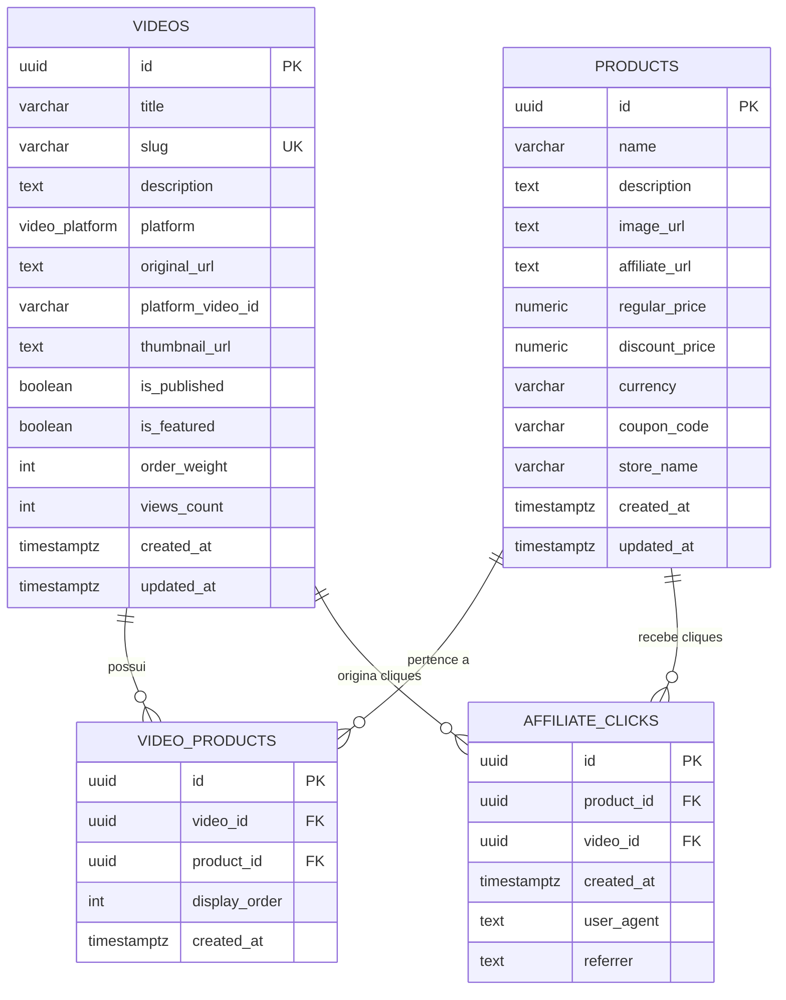

# Modelagem e Dicionário do Banco de Dados — PromoCuts

Este documento documenta o esquema de banco de dados do **PromoCuts**, construído sobre o **PostgreSQL** gerenciado pelo **Supabase**.

---

## 1. Diagrama Entidade-Relacionamento (ERD)

---

## 2. Dicionário de Dados

### 2.1 Tabela `public.videos`

Armazena as informações dos cortes de vídeo e os dados de incorporação.

| Coluna              | Tipo             | Nulo | Padrão               | Descrição                                                 |
| :------------------ | :--------------- | :--: | :------------------- | :-------------------------------------------------------- |
| `id`                | `UUID`           | Não  | `uuid_generate_v4()` | Identificador único do vídeo                              |
| `title`             | `VARCHAR(255)`   | Não  | —                    | Título amigável do corte para SEO e acessibilidade        |
| `slug`              | `VARCHAR(255)`   | Não  | —                    | Identificador amigável na URL (`/v/corte-slug`)           |
| `description`       | `TEXT`           | Sim  | `NULL`               | Descrição opcional ou resumo do conteúdo                  |
| `platform`          | `video_platform` | Não  | —                    | Enum restrito: `'tiktok'`, `'reels'` ou `'shorts'`        |
| `original_url`      | `TEXT`           | Não  | —                    | URL original informada no momento do cadastro             |
| `platform_video_id` | `VARCHAR(100)`   | Não  | —                    | ID extraído do vídeo na plataforma de origem              |
| `thumbnail_url`     | `TEXT`           | Sim  | `NULL`               | Miniatura alternativa para carregamento antecipado        |
| `is_published`      | `BOOLEAN`        | Não  | `true`               | Determina se o vídeo está visível na vitrine pública      |
| `is_featured`       | `BOOLEAN`        | Não  | `false`              | Destaque prioritário no topo do feed                      |
| `order_weight`      | `INT`            | Não  | `0`                  | Peso de ordenação manual (maior valor = maior prioridade) |
| `views_count`       | `INT`            | Não  | `0`                  | Contador aproximado de reproduções na plataforma          |
| `created_at`        | `TIMESTAMPTZ`    | Não  | `NOW()`              | Data e hora de criação do registro                        |
| `updated_at`        | `TIMESTAMPTZ`    | Não  | `NOW()`              | Data e hora da última alteração (via trigger)             |

---

### 2.2 Tabela `public.products`

Armazena o catálogo de itens recomendados com links de afiliados.

| Coluna           | Tipo            | Nulo | Padrão               | Descrição                                           |
| :--------------- | :-------------- | :--: | :------------------- | :-------------------------------------------------- |
| `id`             | `UUID`          | Não  | `uuid_generate_v4()` | Identificador único do produto                      |
| `name`           | `VARCHAR(255)`  | Não  | —                    | Nome comercial do produto                           |
| `description`    | `TEXT`          | Sim  | `NULL`               | Detalhes curtos ou diferencial do produto           |
| `image_url`      | `TEXT`          | Não  | —                    | URL da imagem do produto (hospedada na loja ou CDN) |
| `affiliate_url`  | `TEXT`          | Não  | —                    | Link de redirecionamento com código de comissão     |
| `regular_price`  | `NUMERIC(10,2)` | Sim  | `NULL`               | Preço original do item (para exibição de desconto)  |
| `discount_price` | `NUMERIC(10,2)` | Sim  | `NULL`               | Preço final com desconto ativo                      |
| `currency`       | `VARCHAR(10)`   | Não  | `'BRL'`              | Código da moeda (padrão: real brasileiro)           |
| `coupon_code`    | `VARCHAR(100)`  | Sim  | `NULL`               | Código promocional para cópia rápida                |
| `store_name`     | `VARCHAR(100)`  | Não  | —                    | Nome da loja (ex: "Amazon", "Shopee", "AliExpress") |
| `created_at`     | `TIMESTAMPTZ`   | Não  | `NOW()`              | Data e hora de inclusão                             |
| `updated_at`     | `TIMESTAMPTZ`   | Não  | `NOW()`              | Data e hora da última atualização                   |

---

### 2.3 Tabela `public.video_products`

Tabela de associação de muitos-para-muitos entre vídeos e produtos.

| Coluna          | Tipo          | Nulo | Padrão               | Descrição                                                 |
| :-------------- | :------------ | :--: | :------------------- | :-------------------------------------------------------- |
| `id`            | `UUID`        | Não  | `uuid_generate_v4()` | Identificador da relação                                  |
| `video_id`      | `UUID`        | Não  | —                    | Referência à tabela `public.videos` (ON DELETE CASCADE)   |
| `product_id`    | `UUID`        | Não  | —                    | Referência à tabela `public.products` (ON DELETE CASCADE) |
| `display_order` | `INT`         | Não  | `0`                  | Ordem de aparição do produto no card daquele vídeo        |
| `created_at`    | `TIMESTAMPTZ` | Não  | `NOW()`              | Data da associação                                        |

_Restrição:_ Chave única composta `UNIQUE(video_id, product_id)` para impedir associações duplicadas.

---

### 2.4 Tabela `public.affiliate_clicks`

Registros anônimos de engajamento para cálculo de métricas de conversão.

| Coluna       | Tipo          | Nulo | Padrão               | Descrição                                        |
| :----------- | :------------ | :--: | :------------------- | :----------------------------------------------- |
| `id`         | `UUID`        | Não  | `uuid_generate_v4()` | Identificador do evento                          |
| `product_id` | `UUID`        | Não  | —                    | Referência ao produto clicado                    |
| `video_id`   | `UUID`        | Sim  | `NULL`               | Referência ao vídeo de onde partiu o clique      |
| `created_at` | `TIMESTAMPTZ` | Não  | `NOW()`              | Data e hora do clique                            |
| `user_agent` | `TEXT`        | Sim  | `NULL`               | Informação simplificada do navegador/dispositivo |
| `referrer`   | `TEXT`        | Sim  | `NULL`               | Origem da requisição                             |

---

## 3. Políticas de Segurança (Row Level Security - RLS)

Todas as tabelas possuem a opção `ROW LEVEL SECURITY` estritamente ativada:

1. **Leitura Pública de Vídeos:**
    - Apenas registros com `is_published = true` podem ser lidos por conexões anônimas.
2. **Leitura Pública de Produtos:**
    - Produtos só são listados para o público se estiverem atrelados a pelo menos um vídeo com `is_published = true`.
3. **Escrita Restrita:**
    - Operações de `INSERT`, `UPDATE` e `DELETE` nas tabelas principais são bloqueadas para o papel anônimo (`anon`).
    - Elas são realizadas pelas Server Actions autenticadas do Next.js via chave de serviço (`service_role`), após validação estrita da sessão de e-mail do administrador.
4. **Registro de Métricas Anônimas:**
    - A tabela `affiliate_clicks` permite apenas a operação de `INSERT` pelo público (`anon` e `authenticated`), garantindo que visitantes possam registrar seus cliques sem autorização de leitura da base de dados analítica.

---

## 4. Como Aplicar as Migrações

1. Acesse o [Painel do Supabase](https://supabase.com/dashboard).
2. Selecione o projeto desejado ou crie um novo gratuitamente.
3. No menu lateral esquerdo, clique no ícone **SQL Editor** (ícone de terminal/código).
4. Abra o arquivo local [`supabase/migrations/001_initial_schema.sql`](../supabase/migrations/001_initial_schema.sql) do projeto.
5. Copie todo o conteúdo, cole na janela do SQL Editor e clique no botão **Run** (Executar).
6. O retorno exibirá `Success. No rows returned`, confirmando que todas as tabelas, tipos, funções, triggers e políticas de segurança foram criados.
